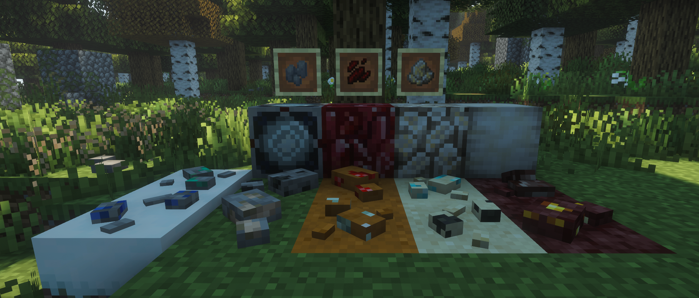

Surface Samples
=======

Surface Samples is a simple mod to do a simple thing: add small indicator blocks that worldgen mods can use as markers for ore deposits. I created this with EnderLanky's fantastic [Large Ore Deposits](https://www.curseforge.com/minecraft/mc-mods/large-ore-deposits) mod in mind, but you can use it with any mod that allows you to specify blocks as markers. You could even use them solely as decoration for creative builds. The samples drop nuggets of their respective ores when right-clicked or destroyed, and are waterloggable, and snowloggable with [Snow! Real Magic](https://modrinth.com/mod/snow-real-magic).

THIS MOD DOES NOT IMPACT WORLDGEN, FOR THESE TO APPEAR NATURALLY YOU WILL NEED A WORLDGEN MOD LIKE LARGE ORE DEPOSITS.

There are ore samples for all vanilla ores, including nether variants for gold, quartz, and netherite. There is also a flint sample that drops one flint, for use in modpacks that over-rely on flint RNG. I've also included a non-nether variant of quartz, which by default drops [Sky's Overworld Quartz](https://modrinth.com/mod/skys-overworld-quartz) shards.

Currently, there are also samples for the following mods' ores:
- Create
- Immersive Engineering
- Mekanism

There are blockstate variants for sandy and red sandy environments, these live under the `flavour` blockstate; the values are `stony`, `sandy`, and `red_sandy` Large Ore Deposits now has configs for Surface Samples by default!

[Mekanism & ImEng samples](images/new%20samples.png)

It also adds in four other blocks:
- Crystallised redstone, which is a concentrated block of redstone that acts as a hybrid between a redstone block and redstone ore
- Glowquartz, which is intended to be used as an early-game alternative to glowstone
- Polished glowquartz, which has a different look and a higher light level
- Glowquartz lamp, a redstone lamp equivalent

Intermediary items have been added for glowquartz, crystallised redstone, and andesite samples (since having a small sample drop an entire block felt strange).

All blocks and items have [Create](https://modrinth.com/mod/create) integration out of the box.

To change the drops of the samples, you can use a datapack, targeting `data/surfacesamples/loot_table/blocks`

This mod was created for a private SMP I am setting up, and so will likely get intermittent updates, but feel free to suggest changes or ore samples you'd like to see, I'll try to get to them one way or another :)

Inspiration from this mod stems from [oitsjustjose's Geolosys](https://modrinth.com/mod/geolosys) and Vintage Story's ore samples.

This is my first venture into minecraft modding, I hope you like it as much as I do :3

This project wouldn't exist without those credited below, so if you want to use this for inspiration or reference, go for it.

If you want to use this in a modpack be my guest! It'd be polite to credit me, but don't feel like you have to. If you use it in a video though, I'd appreciate credit. And if you use it to make something even cooler, show me!

Attribution/Credits:
=======
- [Large Ore Deposits](https://www.curseforge.com/minecraft/mc-mods/large-ore-deposits) for inspiring me to make this mod in the first place
- Quartz sample textures taken from [Sky's overworld quartz](https://modrinth.com/mod/skys-overworld-quartz)
- Snippets of code from [Kaupenjoe's fantastic tutorial series](https://www.youtube.com/playlist?list=PLKGarocXCE1G6CQOoiYdMVx-E1d9F_itF)
- Zinc ore texture from [Create](https://modrinth.com/mod/create)
- Andesite chunks, glowquartz shard, and crystallised redstone shard textures adapted from [Malcomriley's Unused Textures](https://github.com/malcolmriley/unused-textures)
- Glowquartz & crystallised redstone block textures also assembled from malcomriley's item sprites
- Sample pickup behaviour inspired by [Geolosys](https://modrinth.com/mod/geolosys) and Vintage Story
- Sample model inspired by Vintage Story
- Uranium, Alumin(i)um, Silver, and Nickel textures taken and modified from [Immersive Engineering](https://github.com/BluSunrize/ImmersiveEngineering) with permission from BluSunrize
- Lead, Osmium, Flourite, and Tin ore textures taken and modified from [Mekanism](https://github.com/mekanism/mekanism)

Regarding Creativity
=======
I do not and never will use AI in my creations. The code, models, and artwork in this may not be perfect, but they are mine unless specified above, as are any modifications I've made to the sources listed above.